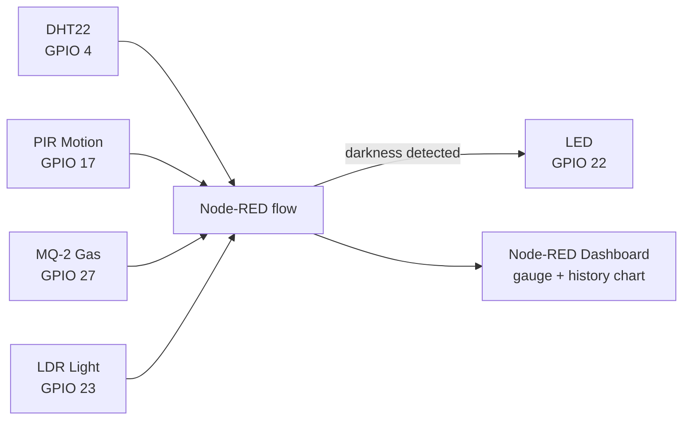

<div align="center">


</div>

## 📌 Overview

Manually checking environmental conditions in a room — temperature, light, motion, gas leakage — is slow and unreliable. This project automates it: a Raspberry Pi reads four sensors over GPIO, Node-RED processes the readings and drives a live dashboard, and an LED is switched automatically based on ambient light. It's a hands-on demonstration of real-time monitoring and hardware–software integration built entirely on Raspberry Pi + Node-RED, with no cloud backend required.

## ✨ Features

- 🌡️ Live temperature reading via a DHT22 sensor, shown as a dashboard gauge
- 📈 Temperature history chart built from streamed Node-RED data
- 🚶 Motion detection using a PIR sensor
- 🔥 Gas/smoke leakage detection using an MQ-2 sensor
- 💡 Automatic LED control based on an LDR light sensor — turns on in darkness, no manual switch
- 🔌 Entirely wired and processed on-device via Raspberry Pi GPIO, no external service dependency
- 🎥 Demo video and wiring diagram included in the repo

## 🛠️ Tech Stack

| Layer | Technology |
|---|---|
| Hardware |  DHT22 · PIR motion sensor · MQ-2 gas sensor · LDR · LED |
| Flow / Logic |  GPIO nodes |
| Dashboard | Node-RED Dashboard (gauge + chart widgets) |
| OS | Raspberry Pi OS |

## 🏗️ Architecture



## 📂 Project Structure

```
raspberry-pi-iot-environment-monitoring/
├── flows.json                          # Node-RED flow — import this
├── wiring-diagram.jpg.jpg               # Sensor-to-GPIO wiring diagram
├── temperature-dashboard.mp4            # Demo video of the live dashboard
├── IoT_Environment_Monitoring_Report.pdf # Full project report
└── README.md
```

## ⚙️ Installation

```bash
git clone https://github.com/Fayaz-2007/raspberry-pi-iot-environment-monitoring.git
cd raspberry-pi-iot-environment-monitoring
```

1. Flash and boot **Raspberry Pi OS** on the Pi.
2. Install **Node-RED** on the Pi (`sudo apt install -y nodered` or the official Node-RED install script).
3. Wire the sensors as per `wiring-diagram.jpg.jpg`:

| Component | GPIO Pin |
|---|---|
| DHT22 (temperature) | GPIO 4 |
| PIR motion sensor | GPIO 17 |
| MQ-2 gas sensor (DO pin) | GPIO 27 |
| LDR (light sensor) | GPIO 23 |
| LED | GPIO 22 |

All sensors share common GND and the required power pins.

4. Start Node-RED and open the editor at `http://<pi-ip>:1880`.
5. Import `flows.json` into Node-RED and click **Deploy**.
6. Open the dashboard at `http://<pi-ip>:1880/ui`.

## 🚀 Usage

1. Power on the Pi with all sensors wired as above and the flow deployed.
2. Watch the live temperature gauge and history chart update on the Node-RED Dashboard.
3. Walk in front of the PIR sensor to trigger motion detection.
4. Cover the LDR to see the LED switch on automatically in darkness.
5. See `temperature-dashboard.mp4` in this repo for a recorded demo, and `IoT_Environment_Monitoring_Report.pdf` for the full write-up with screenshots.

`[Screenshot: Node-RED dashboard — temperature gauge and history chart]`

## 🔮 Future Improvements

- Push sensor readings to a cloud dashboard or MQTT broker for remote monitoring
- Add SMS/push alerts when gas levels cross a danger threshold
- Log historical readings to a database instead of in-memory Node-RED context
- Add a buzzer for audible gas-leak alerts alongside the dashboard indicator

## 👨‍💻 Author

**Fayaz Ahmed**
GitHub: [@Fayaz-2007](https://github.com/Fayaz-2007)
LinkedIn: [fayaz-ahmed-59287631a](https://linkedin.com/in/fayaz-ahmed-59287631a)

<div align="center">


</div>
